<!--
  GitHub profile README — Sarai Soliman
  ─────────────────────────────────────
  • Graphics in assets/ are generated. Edit profile.json, then run:  python tools/build_assets.py
    (the build also refreshes the stack table between the "stack:start/stack:end" markers below).
  • Everything in [SQUARE BRACKETS AND CAPITALS] is a placeholder that still needs real information.
  • Design notes and GitHub rendering limits: docs/DESIGN.md
  curiosity NOT NULL
-->

  

  <a href="#about">About</a> ·
  <a href="#stack">Stack</a> ·
  <a href="#round-trip">Round trip</a> ·
  <a href="#showcase">Showcase</a> ·
  <a href="#mindset">Mindset</a> ·
  <a href="#learning">Learning</a> ·
  <a href="#connect">Connect</a>

## About

<code>01</code> — an engineering story in three acts

I'm **Sarai Soliman**, a recent IT Engineering graduate building a career in software development.
I like knowing how a system works all the way through: from the table that stores a fact to the screen where someone uses it.

**I. Understand.** I start where the problem lives — who will use the software, what they actually need, and what can go wrong.

**II. Model.** Then I give the data a shape: entities, relationships and constraints. A clear schema makes everything built on top of it simpler.

**III. Build the round trip.** From there I work on both sides — APIs that validate and protect, and interfaces that make the result feel obvious.

I'm early in my career, and I'd rather say so plainly: I'm building practical projects, reading other people's code, and getting a little better every week.
**Open to junior software development opportunities.**

## Stack

<code>02</code> — what I work with, modelled the way I'd model anything: as a schema


<b>Read the schema as plain text</b>

 

<!-- stack:start — generated from profile.json by tools/build_assets.py; edits here are overwritten -->
| Area | Practiced | Learning | Studied in theory |
|---|---|---|---|
| Programming fundamentals | C++ · C# · Object-oriented (OOP) | — | Data structures & algorithms |
| Frontend | HTML · CSS · JavaScript · Responsive design | React | — |
| Backend & APIs | Python · REST APIs | FastAPI · JWT authentication | — |
| Databases & data modelling | SQL · PostgreSQL · SQL Server · ER diagrams · Normalization | Alembic migrations | — |
| ERP | — | Odoo · Python modules | ORM concepts · ERP workflows |
| Tools | Git · GitHub · Linux · VS Code · Visual Studio · npm | — | — |
<!-- stack:end -->

*Practiced* = used hands-on in coursework or projects · *Learning* = actively learning now · *Studied* = covered in theory. These describe exposure, not expertise.

## Round trip

<code>03</code> — frontend, backend and database: three worlds, one request


**Interface → API request → backend logic → database query → response → updated interface.**
I'm interested in all three worlds, and especially in the seams between them — a form that sends the wrong shape, an endpoint that trusts its input, a query that returns more than it should.

<b>What the diagram shows, step by step</b>

 

1. **Event** — the user picks a filter and clicks *Load*; the list shows skeleton rows instead of freezing.
2. **Request** — `GET /api/students?major=IT` with a bearer token.
3. **Logic** — the route matches, the JWT is verified, the input is validated, business rules apply.
4. **Query** — `SELECT … FROM students JOIN majors … WHERE m.code = 'IT'`: a many-to-one relationship doing its job.
5. **Response** — `200 OK` with JSON the frontend can trust.
6. **Render** — skeleton rows become real data.

## Showcase

<code>04</code> — project blueprints: a card gets a link when its repository is public

<!--
  HOW TO PUBLISH A REAL PROJECT CARD
  1. Push the project to a public repository.
  2. Replace every [PLACEHOLDER] in its card below with the real sentence, stack and link.
  3. In profile.json set its status to "live", run python tools/build_assets.py
     (the dashed "blueprint" tag on the illustration becomes a solid "live" tag).
  Delete any card whose project does not exist and that you don't plan to publish.
-->

<table>
<tr>
<td width="50%" valign="top">


**Student Management System** <code>blueprint</code> 
[PLACEHOLDER — the problem it solves] 
Scope: CRUD · OOP · database integration · validation 
Stack: [PLACEHOLDER e.g. C# · SQL Server] 
Repo: [ADD REPOSITORY LINK]

</td>
<td width="50%" valign="top">


**Odoo Custom Module** <code>blueprint</code> 
[PLACEHOLDER — the business workflow it supports] 
Scope: models · ORM relations · views & menus · workflow 
Stack: Python · Odoo · XML 
Repo: [ADD REPOSITORY LINK]

</td>
</tr>
<tr>
<td width="50%" valign="top">


**Full-Stack Web Application** <code>blueprint</code> 
[PLACEHOLDER — who uses it, and for what] 
Scope: frontend · REST API · database · auth 
Stack: [PLACEHOLDER e.g. JavaScript · FastAPI · PostgreSQL] 
Repo: [ADD REPOSITORY LINK]

</td>
<td width="50%" valign="top">


**Database Design Project** <code>blueprint</code> 
[PLACEHOLDER — the domain it models] 
Scope: ER model · schema · normalization · constraints 
Stack: [PLACEHOLDER e.g. PostgreSQL] 
Repo: [ADD REPOSITORY LINK]

</td>
</tr>
</table>

## Mindset

<code>05</code> — how I work, logged the way I'd log anything


## Learning

<code>06</code> — currently learning: a direction, not a score


## Activity

<code>07</code> — real public data, redrawn daily by a GitHub Action


<!--
  OPTIONAL: most-used languages from github-readme-stats (public instance; rate-limited at times,
  self-hosting on Vercel is the reliable option). Replace YOUR_USERNAME, then remove these comment markers.

  

-->

## Connect

<code>08</code> — the response you were waiting for

I'm looking for a junior software development role where I can learn from a strong team and contribute from the first week.
If that sounds like your team — or you just want to talk about schemas — I'd like to hear from you.

**Email** · [ADD PROFESSIONAL EMAIL] &nbsp;&nbsp; **LinkedIn** · [ADD LINKEDIN URL] &nbsp;&nbsp; **GitHub** · [github.com/Eng2b](https://github.com/Eng2b) &nbsp;&nbsp; **Portfolio** · [ADD PORTFOLIO URL — or delete]

